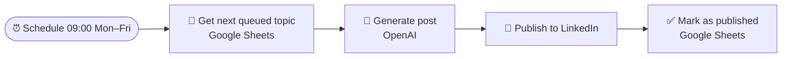
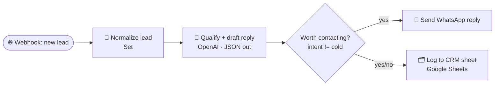
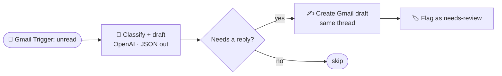

# n8n Automation Workflows

A collection of production-style **[n8n](https://n8n.io)** automation workflows I've built around **LLMs, lead automation, and content ops**. Every workflow here is a real, importable `.json` export, validated against the current n8n node schemas.

> **Author:** Mohammed Haitham El Zamzamy — AI Engineer (LLMs & RAG, Computer Vision, Full-Stack)
> 🌐 [Portfolio](https://mohammed20037.github.io) · 💼 [LinkedIn](https://linkedin.com/in/mohammed-zamzamy) · ⌨️ [GitHub](https://github.com/Mohammed20037)

---

## How to use

1. Open your n8n instance → **Workflows** → **Import from File**.
2. Pick any JSON in [`/workflows`](./workflows).
3. Add your own credentials (OpenAI, Gmail, Google Sheets, LinkedIn, WhatsApp Cloud API) and replace the `YOUR_*` placeholders.
4. Activate.

All LLM steps use `gpt-4o-mini` by default — swap for any model your n8n OpenAI credential supports.

---

## 1. AI Daily Content Publisher
**File:** [`workflows/01-ai-daily-content-publisher.json`](./workflows/01-ai-daily-content-publisher.json)

Every weekday at 09:00, pulls the next queued topic from a Google Sheet, generates a LinkedIn post with an LLM, publishes it, and marks the row as published — a hands-off daily content pipeline.

**Nodes:** Schedule Trigger · Google Sheets · OpenAI · LinkedIn
**Use case:** always-on personal/brand content without manual drafting.

---

## 2. Lead Capture → AI Qualify → WhatsApp Auto-Responder
**File:** [`workflows/02-lead-capture-whatsapp-autoresponder.json`](./workflows/02-lead-capture-whatsapp-autoresponder.json)

A webhook receives leads (website form, Meta/TikTok/Snapchat lead ads, etc.). An LLM qualifies intent (hot/warm/cold) and drafts a first reply in the lead's language. Non-cold leads get an instant WhatsApp message; every lead is logged to a CRM sheet.

**Nodes:** Webhook · Set · OpenAI · IF · WhatsApp Business Cloud · Google Sheets
**Use case:** instant speed-to-lead response for recruitment or sales funnels.

---

## 3. AI Email Auto-Reply Drafter (Gmail)
**File:** [`workflows/03-ai-email-autoreply-drafter.json`](./workflows/03-ai-email-autoreply-drafter.json)

Polls Gmail for new unread primary-inbox email. An LLM classifies each message and drafts a reply. If a reply is warranted, it creates a **Gmail draft** on the same thread and flags the message for human review — AI does the first draft, a human still hits send.

**Nodes:** Gmail Trigger · OpenAI · IF · Gmail (draft + label)
**Use case:** zero-inbox assistant that drafts, never auto-sends.

---

## Notes
- Placeholders like `YOUR_GOOGLE_SHEET_ID`, `YOUR_WABA_PHONE_NUMBER_ID`, and `YOUR_LINKEDIN_PERSON_URN` must be filled with your own values.
- Workflows are shipped **inactive** and contain no secrets — credentials are referenced by n8n credential type, not embedded.
- Built and validated on n8n `2.x`.

## License
MIT — free to use, adapt, and learn from.
